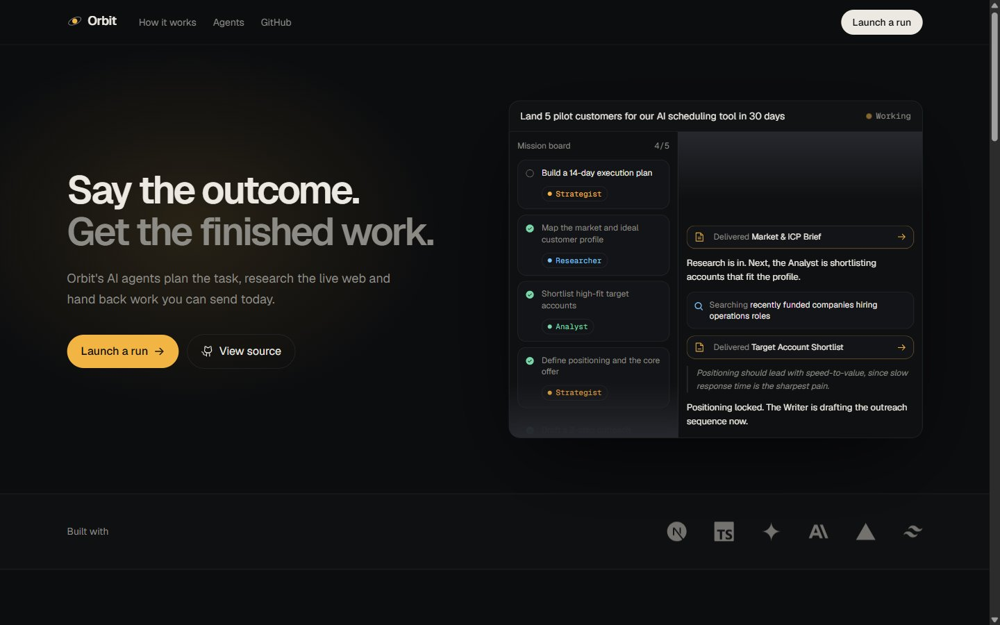

# Orbit: an AI operations team

Describe a business outcome in one sentence. Orbit's four agents (Researcher, Analyst, Strategist, Writer) break it into a mission plan, research it on the live web, and hand back finished work: lead lists, outreach emails, briefs and plans. You watch every step stream in as it happens.

**[Try it live → orbit-ai-agents.vercel.app](https://orbit-ai-agents.vercel.app)**. Visitors see a full demo run; live runs on the public site need an access code.



## What it shows off

- **A real agent loop.** It's a hand-written streaming tool-use loop, not a single prompt. The model calls its own tools to plan (`create_tasks`), track progress (`update_task`), ship work (`publish_deliverable`) and finish (`finish`).
- **Two providers, one mission engine.** It runs free on **Google Gemini** (`gemini-2.5-flash` by default, falling back to other Flash models when one is busy) or on **Claude Opus 5.5**. The tools, validation and UI events are shared in `src/lib/mission.ts`, and each provider has a thin loop on top.
- **Live web research.** Gemini searches through Tavily's free tier, and Claude uses Anthropic's server-side `web_search`. Sources show up in the feed and are cited inside deliverables.
- **Free-tier aware.** When Gemini hits its rate limit (429 or 503), the run waits and retries with backoff instead of failing.
- **Streaming UX.** Reasoning summaries, narration, searches, task changes and deliverables stream to the browser as NDJSON and render live on a three-panel workspace.
- **Production details.** Tool inputs are validated with Zod. The loop handles `pause_turn`, `refusal` and `max_tokens`, uses typed API errors, caches the system prompt and has server-side refusal fallbacks. Stop/abort works end to end, and the last run is restored after a page refresh.
- **Demo mode.** With no API key, a scripted run plays instead, so a public deploy always works.

## Architecture

```
Browser (Next.js client)                 Server (Next.js route, Node runtime)
┌───────────────────────────┐  POST     ┌──────────────────────────────────────┐
│ /workspace                │ /api/run  │ runAgent(goal)                       │
│  Mission board            │ ────────► │  loop: messages.stream(...)          │
│  Live feed                │           │   ├─ web_search (server tool)        │
│  Deliverables + viewer    │ ◄──────── │   ├─ create_tasks / update_task      │
│ useRun(): NDJSON reducer  │  NDJSON   │   ├─ publish_deliverable             │
└───────────────────────────┘  events   │   └─ finish                          │
                                        └──────────────────────────────────────┘
```

| File | Role |
|---|---|
| `src/lib/mission.ts` | System prompt, tool schemas, tool executor (provider-neutral) |
| `src/lib/gemini.ts` | Gemini agent loop with Tavily web search and rate-limit retries |
| `src/lib/agent.ts` | Claude agent loop with server-side web search |
| `src/lib/demo.ts` | Scripted run for demo mode |
| `src/lib/events.ts` | Typed event protocol shared by server and client |
| `src/app/api/run/route.ts` | Streams events, maps API errors to readable messages |
| `src/lib/useRun.ts` | Client reducer that turns the event stream into UI state |
| `src/app/workspace/Workspace.tsx` | The workspace UI |

## Run it locally

```bash
npm install
cp .env.example .env.local
npm run dev
```

Open http://localhost:3000. Keys go in `.env.local`, and all of them are optional:

| Key | Cost | Where to get it |
|---|---|---|
| `GEMINI_API_KEY` | Free tier | https://aistudio.google.com/apikey |
| `TAVILY_API_KEY` | Free, 1,000 searches a month | https://app.tavily.com |
| `ANTHROPIC_API_KEY` | Paid | https://platform.claude.com |
| `ORBIT_ACCESS_CODE` | - | Any secret phrase you choose. Live runs then need it, and visitors without it get the demo |

If `GEMINI_API_KEY` is set, Gemini runs the mission. Otherwise Claude runs it if its key is set, and with neither key you get demo mode.

## Deploy

Push to GitHub and import the repo on Vercel. Add the same keys as environment variables to enable live runs. On a public deploy, also set `ORBIT_ACCESS_CODE` so strangers can't use up your quota. A live run can take a few minutes, and the route sets `maxDuration = 300`, which needs a Vercel plan that allows 300-second functions.

## Ideas for next steps

- Sign-in and saved run history (Supabase)
- Export deliverables to Google Docs or Notion
- Let the user approve the plan before agents start
- Scheduled runs ("every Monday, refresh my lead list")
